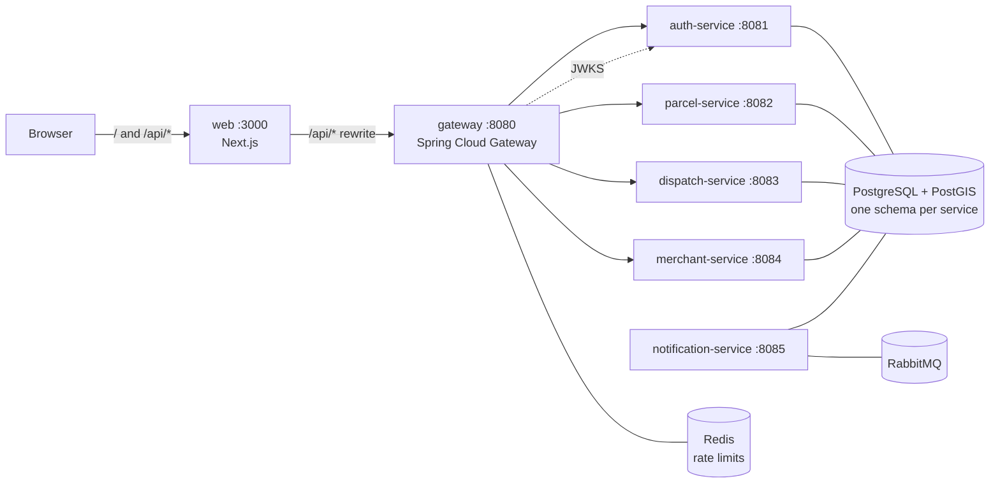

# SwiftDrop

Parcel delivery and courier management platform for Sri Lanka. Phase 1 delivers the platform skeleton:
complete authentication (email/password and Google), role-based access for every role, and one
`docker compose up` that runs the whole stack. Parcels, dispatch, events and webhooks arrive in later phases.

**Roles:** `CUSTOMER`, `MERCHANT` (needs admin approval), `COURIER`, `DISPATCHER`, `ADMIN`.

## Architecture



| Component | Port | What it does |
|---|---|---|
| web | 3000 | Next.js 15 app. Proxies `/api/*` to the gateway so auth cookies are first-party |
| gateway | 8080 | Routing, JWT check (Bearer header or `sd_access` cookie), coarse role rules, Redis rate limit on login/signup/refresh, CORS, `X-Request-Id` |
| auth-service | 8081 | Signup, login, RS256 JWTs + rotating refresh tokens, Google OAuth (PKCE), JWKS, merchant approval, staff accounts |
| parcel-service | 8082 | Skeleton. `GET /api/v1/parcels/ping`, any signed-in user |
| dispatch-service | 8083 | Skeleton. `GET /api/v1/dispatch/ping`, DISPATCHER or ADMIN |
| merchant-service | 8084 | Skeleton. `GET /api/v1/merchant/ping`, approved MERCHANT only |
| notification-service | 8085 | Skeleton. RabbitMQ health check, listener placeholder for `parcel.status.changed` |
| PostgreSQL 16 + PostGIS | 5432 | One login and one schema per service (`auth`, `parcel`, `dispatch`, `merchant`, `notification`) |
| RabbitMQ | 5672, UI 15672 | Messaging (Phase 2) |
| Redis | internal | Gateway rate limiting |
| MinIO | 9000, console 9001 | Object storage (Phase 2) |
| Mailpit | SMTP 1025, UI 8025 | Catches outgoing email in dev |

**Stack:** Java 21, Spring Boot 3.5, Spring Cloud 2025.0, Maven multi-module. Next.js 15 (App Router), TypeScript,
Tailwind CSS 4, shadcn/ui, React Hook Form + Zod, TanStack Query.

### How auth works

- **Access token:** RS256 JWT, 15 minutes, claims `sub`, `roles`, `merchantStatus` (merchants only), `iss`, `exp`.
  Stored in the `sd_access` cookie (HttpOnly, SameSite=Lax). Never in localStorage.
- **Refresh token:** opaque random value, 7 days, cookie `sd_refresh` scoped to `/api/v1/auth`. Only its SHA-256
  hash is stored. Every refresh rotates it. Presenting an already-rotated token revokes the whole family
  (everything issued since that login), which signs out a thief and the victim alike.
- **Verification:** the gateway and every service validate tokens against `auth-service`'s
  `/.well-known/jwks.json`. The gateway applies coarse rules per route prefix; services re-check with `@PreAuthorize`.
- **Web app:** `middleware.ts` reads the roles in `sd_access` to send users to the right dashboard. The single
  API client (`apps/web/src/lib/api.ts`) calls `/refresh` once on a 401 and retries.
- **Phone numbers** are encrypted at rest with AES-256-GCM. **Passwords** use BCrypt (cost 12).
- **Logs** mask emails, Sri Lankan phone numbers, JWTs and password values, and carry the request ID.

### Same-origin setup (why everything goes through :3000)

The browser only ever talks to `http://localhost:3000`. `apps/web/next.config.ts` rewrites `/api/*` to the gateway,
so the auth cookies belong to the web app's origin and work without third-party-cookie or CORS tricks.
Google therefore redirects back to the **web app**, not the backend:

```
http://localhost:3000/api/v1/auth/oauth2/callback/google
```

auth-service builds this redirect URI from `WEB_APP_URL` rather than from the request's host, because the request
reaches it through two proxies (Next.js, then the gateway). Forwarded-header support
(`server.forward-headers-strategy: framework`) is also on for any other absolute URLs.

## Prerequisites

- Docker Desktop (or Docker Engine) with Compose v2, about 6 GB free RAM
- `bash` and `openssl` for `scripts/dev-keys.sh` (Git Bash works on Windows)
- For running outside Docker: JDK 21+, Maven 3.9+, Node.js 24+

## Run it

```bash
cd infra/compose
cp .env.example .env          # optional: dev-keys.sh does this if .env is missing
../../scripts/dev-keys.sh     # generates the JWT keypair and fills every empty secret
docker compose up --build
```

Open <http://localhost:3000>. The first build takes a few minutes. `docker compose ps` should show every container
as `healthy`.

`scripts/dev-keys.sh` only fills values that are empty, so re-running it is safe. It prints the seed account
password. To start over completely: `docker compose down -v` (deletes the database volume).

### Seed accounts

With `SEED_DEMO_DATA=true` (the default in `.env.example`), auth-service creates these on startup. They all use
the password in `SEED_PASSWORD`.

| Email | Role |
|---|---|
| `admin@swiftdrop.test` | ADMIN |
| `dispatcher@swiftdrop.test` | DISPATCHER |
| `courier1@swiftdrop.test`, `courier2@swiftdrop.test` | COURIER |
| `customer@swiftdrop.test` | CUSTOMER |
| `merchant@swiftdrop.test` | MERCHANT (approved) |
| `pending-merchant@swiftdrop.test` | MERCHANT (pending approval) |

Never set `SEED_DEMO_DATA=true` in production.

### Google sign-in setup

1. Google Cloud Console > APIs & Services > **OAuth consent screen**: create an External app and add your Google
   account under *Test users*.
2. **Credentials** > Create credentials > **OAuth client ID** > *Web application*.
3. **Authorized JavaScript origins:** `http://localhost:3000`
4. **Authorized redirect URIs:** `http://localhost:3000/api/v1/auth/oauth2/callback/google`
5. Put the client ID and secret into `infra/compose/.env` as `GOOGLE_CLIENT_ID` / `GOOGLE_CLIENT_SECRET`, then
   `docker compose up -d auth-service`.

If you deploy under another URL, change `WEB_APP_URL` and register `${WEB_APP_URL}/api/v1/auth/oauth2/callback/google`.

New Google users become customers. A Google account whose **verified** email matches an existing account is
linked to that account. Unverified Google emails are refused.

### Useful knobs (`infra/compose/.env`)

| Variable | Purpose |
|---|---|
| `JWT_ACCESS_TTL` | Set to `PT1M` to watch silent refresh happen. Tokens are accepted for 60 s past expiry (clock skew), so the first refresh happens after about 2 minutes |
| `COOKIE_SECURE` | `true` behind HTTPS |
| `SEED_DEMO_DATA` / `SEED_PASSWORD` | Demo accounts |

Every variable is documented in [`infra/compose/.env.example`](infra/compose/.env.example).

## API overview

All routes go through the gateway (or `http://localhost:3000/api/...` from the browser).

| Method | Path | Access |
|---|---|---|
| POST | `/api/v1/auth/signup` | public (rate limited) |
| POST | `/api/v1/auth/signup/merchant` | public (rate limited) |
| POST | `/api/v1/auth/login` | public (rate limited) |
| POST | `/api/v1/auth/refresh` | public, uses `sd_refresh` cookie (rate limited) |
| POST | `/api/v1/auth/logout` | signed in |
| GET | `/api/v1/auth/me` | signed in |
| GET | `/api/v1/auth/oauth2/authorize/google` | public |
| GET | `/api/v1/auth/oauth2/callback/google` | public (Google redirects here) |
| GET | `/api/v1/auth/admin/merchants?status=PENDING` | ADMIN |
| POST | `/api/v1/auth/admin/merchants/{id}/approve` | ADMIN |
| POST | `/api/v1/auth/admin/merchants/{id}/reject` (`{"reason": "..."}`) | ADMIN |
| POST | `/api/v1/auth/admin/users` (role `COURIER` or `DISPATCHER`) | ADMIN |
| GET | `/.well-known/jwks.json` | public |

Errors are RFC 7807 `application/problem+json` with a `traceId` (the `X-Request-Id`). Validation errors add
`errors: [{field, message}]`.

## Tests and coverage

```bash
mvn verify                         # all modules; Testcontainers needs Docker running
cd apps/web && npm ci && npm test  # Vitest: Zod schemas + API client refresh/retry
npm run lint && npm run typecheck
```

- Coverage report (all modules merged): `services/coverage/target/site/jacoco-aggregate/index.html`
- Per module: `services/<module>/target/site/jacoco/index.html`
- auth-service fails the build below 70% line coverage.

What is covered: password and phone rules, token issuing/parsing, refresh rotation and reuse detection, Google
account linking, the full signup > login > me > refresh > logout flow against a real Postgres, 409 on duplicate
email, the generic 401 on bad credentials, RBAC at each service (customer vs admin endpoints, courier vs dispatch,
pending vs approved merchant, no token) and at the gateway (public routes, 401 without a token, role rules per
prefix, CORS, request IDs).

CI (`.github/workflows/ci.yml`) runs all of this on every push and PR, uploads the JaCoCo report as an artifact
and builds every Docker image without pushing.

## Running a service outside Docker

Start the infrastructure, then run a service with Maven. Defaults in each `application.yml` point at `localhost`.

```bash
cd infra/compose && docker compose up -d postgres redis rabbitmq
export DB_PASSWORD=<AUTH_DB_PASSWORD from .env> PII_ENCRYPTION_KEY=<from .env>
mvn -q install -DskipTests            # once, so common-lib is in your local repo
mvn -pl services/auth-service spring-boot:run
cd apps/web && npm run dev          # GATEWAY_URL defaults to http://localhost:8080
```

Without `JWT_PRIVATE_KEY`/`JWT_PUBLIC_KEY`, auth-service logs a warning and uses a throwaway keypair.

## Folder structure

```
swiftdrop/
├─ services/
│  ├─ common-lib/            shared ProblemDetail errors, JWT resource-server config, request IDs,
│  │                         PII-masking logback config, CurrentUser helper
│  ├─ gateway/               Spring Cloud Gateway (reactive)
│  ├─ auth-service/          api/ config/ domain/ oauth/ repository/ service/ + Flyway in resources/db/migration
│  ├─ parcel-service/        skeleton: api/ domain/ service/ repository/ config/
│  ├─ dispatch-service/      skeleton
│  ├─ merchant-service/      skeleton
│  ├─ notification-service/  skeleton + RabbitMQ
│  ├─ coverage/              JaCoCo aggregate report (no code)
│  └─ Dockerfile             one multi-stage image definition for every Spring service
├─ apps/web/                 Next.js app (src/app pages, src/lib api client + schemas, src/middleware.ts)
├─ infra/compose/            docker-compose.yml, .env.example, Postgres init script
├─ infra/helm/               placeholder (Phase 2)
├─ docs/diagrams/            PlantUML / Mermaid sources
├─ scripts/dev-keys.sh       RSA keypair + secrets into infra/compose/.env
├─ .github/workflows/ci.yml
└─ pom.xml                   parent POM
```

### Adding a Phase 2 feature to a skeleton service

Put entities in `domain/`, Spring Data repositories in `repository/`, logic in `service/` and controllers and DTOs
in `api/`. Add tables as `V2__*.sql` in that service's `db/migration`. Protect endpoints with `@PreAuthorize` and
use `CurrentUser.id()` / `CurrentUser.roles()` for the caller. Throw `ResponseStatusException` for 404/409:
common-lib turns it into a ProblemDetail.

## Known limitations (Phase 1)

- **Rate limiting is per client IP**, taken from the last `X-Forwarded-For` hop set by an edge proxy. Locally
  there is no edge proxy, so all browser traffic through the web container shares one bucket of 10
  login/signup/refresh requests per minute.
- **The web middleware decodes the JWT without verifying it.** It only chooses which page shell to render; every
  API call is verified by the gateway and the services.
- **Merchant rejection** adds a `REJECTED` status and a `rejection_reason` column to `merchant_accounts`. The
  original spec listed only `PENDING`, `APPROVED` and `SUSPENDED`.
- **A merchant sees approval after logging in again** (or at the next token refresh), because the status travels
  in the access token.
- **The "Track a parcel" box is a placeholder** until parcel-service exists.
- **MinIO:** the official `minio/minio` image was removed from Docker Hub, so compose uses the community build
  `pgsty/minio`.
