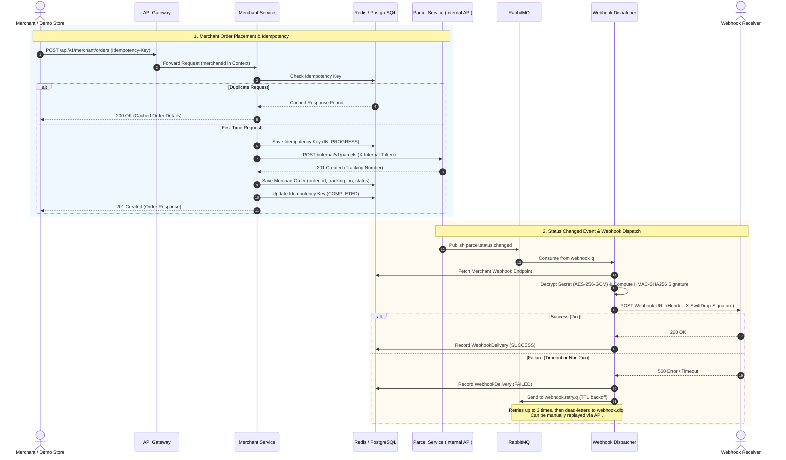

# Member 6: Merchant Integration & Webhook Delivery Engine
**Author**: R.W.P.M.M.K. Herath (Member 6)  
**Service**: `services/merchant-service`  
**Apps**: `apps/demo-store`, `apps/web` (`/merchant`, `/merchant/webhooks`)  
**Specification Reference**: SwiftDrop Phase 2 Architecture & Requirements

---

## 1. Section 3.2: Merchant Use Cases

### UC-M01: Place Merchant Order with Idempotency
- **Actor**: External Merchant / E-Commerce System (or Demo Store simulator).
- **Description**: Merchant places an outbound delivery order for a customer purchase. To safeguard against network disconnects, retry storms, or double billing, each request carries an `Idempotency-Key` header.
- **Preconditions**:
  - Merchant is authenticated (Bearer JWT).
  - Merchant account status is `APPROVED` or `ACTIVE` (Merchants with `PENDING`, `REJECTED`, or `SUSPENDED` are denied with `403 Forbidden`).
- **Main Flow**:
  1. Merchant sends `POST /api/v1/merchant/orders` with `Idempotency-Key` header and order payload (recipient details, parcel weight, dimensions, pickup time, delivery address).
  2. Merchant Service queries the Idempotency Store (Redis with PostgreSQL `idempotency_keys` fallback).
  3. If key is present and completed within the 24-hour window, the cached response payload is immediately returned with identical status code.
  4. If key is new, the request is recorded as `IN_PROGRESS`.
  5. Merchant Service invokes Parcel Service's internal API (`POST /internal/v1/parcels`) authenticated via mutual service-to-service header `X-Internal-Token`.
  6. Parcel Service assigns a unique tracking number (e.g., `SD-XXXX-XXXX`) and persists initial status `CREATED`.
  7. Merchant Service persists `merchant_orders` record bound to `merchant_id` and records the success payload in `idempotency_keys`.
  8. Returns `201 Created` with order ID and parcel tracking number.

---

### UC-M02: Track Merchant Orders & Deliveries
- **Actor**: Merchant User (via Dashboard or API).
- **Description**: View all orders placed by the merchant's account or retrieve status details for a specific order.
- **Endpoints**:
  - `GET /api/v1/merchant/orders`: Paginated list of merchant orders with filtering by status.
  - `GET /api/v1/merchant/orders/{trackingNo}`: Full details of the order, delivery progress, and timeline.
- **Tenant Isolation**: Strictly filtered by `merchant_id` extracted from JWT claims; merchants can never access orders belonging to other tenants.

---

### UC-M03: Webhook Endpoint Configuration & Secret Management
- **Actor**: Merchant Administrator.
- **Description**: Configure a HTTPS endpoint URL and subscribed event types (e.g., `parcel.status.changed`, `parcel.delivered`) to receive asynchronous tracking updates.
- **Endpoints**:
  - `GET /api/v1/merchant/webhook`: Retrieve existing endpoint configuration and status.
  - `PUT /api/v1/merchant/webhook`: Register or update target webhook URL and event subscriptions. Generates a random cryptographic signing secret (`whsec_...`).
  - `POST /api/v1/merchant/webhook/rotate-secret`: Regenerates a new signing secret, invalidating the previous secret.
- **Security & Storage**:
  - Secret keys are encrypted at rest using AES-256-GCM (`SecretEncryptor`) via key `PII_ENCRYPTION_KEY`.
  - Plaintext secret is returned only once upon creation/rotation so the merchant can configure their receiver.

---

### UC-M04: Automated Webhook Dispatch, Signature Verification & Retry with DLQ
- **Actor**: System (Asynchronous Event Consumer).
- **Description**: Whenever parcel status changes in the core platform, Merchant Service dispatches a signed webhook payload to the merchant's endpoint.
- **Flow**:
  1. Parcel Service publishes `parcel.status.changed` to RabbitMQ exchange `parcel.exchange`.
  2. Merchant Service's `WebhookEventListener` consumes event from queue `webhook.q`.
  3. Webhook dispatcher looks up the merchant's active `webhook_endpoints` record.
  4. Computes HMAC-SHA256 signature over `<timestamp>.<payload>` using decrypted secret.
  5. Sends HTTP POST request to merchant's endpoint with header `X-SwiftDrop-Signature: t=<timestamp>,v1=<signature>`.
  6. **On 2xx Success**: Records `webhook_deliveries` record with `SUCCESS` status and response code.
  7. **On Failure (Timeout or Non-2xx)**:
     - Records `webhook_deliveries` record with `FAILED` and error reason.
     - Enqueues message to retry queue `webhook.retry.q` with TTL backoff (up to 3 retries).
     - If all retries fail, message is routed to dead-letter queue `webhook.dlq`.

---

### UC-M05: Webhook Delivery Log Inspection & Manual Replay
- **Actor**: Merchant Administrator.
- **Description**: Inspect delivery audit log (request body, response code, timestamp, error message) and trigger manual retry for failed webhook deliveries.
- **Endpoints**:
  - `GET /api/v1/merchant/webhook/deliveries`: Audit history of webhook attempts.
  - `POST /api/v1/merchant/webhook/deliveries/{id}/replay`: Re-attempts delivery of a historical webhook event.

---

## 2. Section 7.2: Merchant Order Sequence Diagram

The interaction sequence between the Merchant/Demo Store, API Gateway, Merchant Service, Parcel Service, RabbitMQ, and Webhook Receiver is depicted below:

Source files:
- [merchant-order-sequence.puml](file:///c:/Users/ASUS/Desktop/swiftdrop/SwiftDrop/docs/diagrams/merchant-order-sequence.puml)
- [merchant-order-sequence.mmd](file:///c:/Users/ASUS/Desktop/swiftdrop/SwiftDrop/docs/diagrams/merchant-order-sequence.mmd)

---

## 3. Test Verification Matrix (Phase 2 Traceability)

| Test ID | Objective | Test File | Result |
| :--- | :--- | :--- | :--- |
| **T-12** | HMAC-SHA256 Webhook Signature Generation & Verification | `WebhookSignerTest.java` | **PASSED** |
| **T-15** | Idempotency Key Caching & Duplicate Request Handling | `IdempotencyTest.java` | **PASSED** |
| **T-18** | Webhook Dispatch, Retry Backoff (3x), DLQ Routing & Replay | `WebhookRetryTest.java` | **PASSED** |
| **SEC-1**| Role-based Access Control (MERCHANT role enforcement) | `MerchantOrderSecurityTest.java` | **PASSED** |
| **SEC-2**| Tenant Isolation & Status Check (PENDING/SUSPENDED rejection) | `MerchantOrderSecurityTest.java` | **PASSED** |

