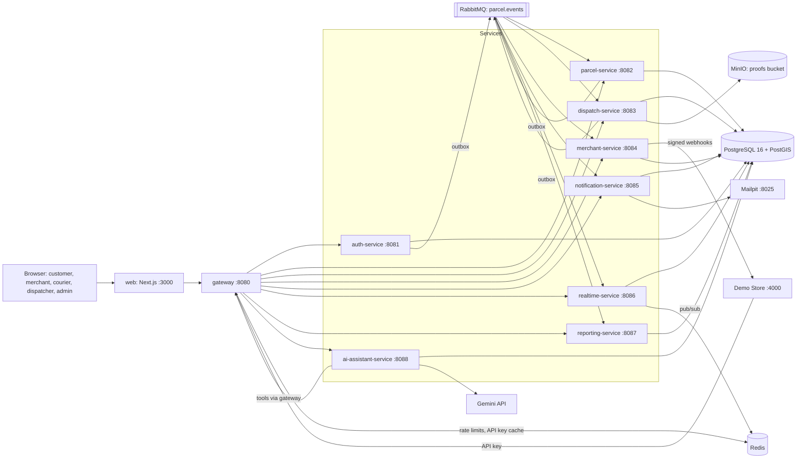
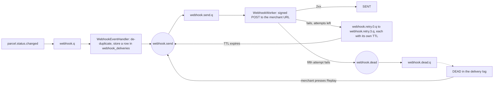

# SwiftDrop Phase 2: the system as built

This is an addendum to the Phase 1 design document. It describes what is in the repository at the end of Phase 2. Every fact here was taken from the code on `fix/final-hardening`. Where this addendum and the Phase 1 document disagree, this one describes the real system.

## 1. Architecture

SwiftDrop is a set of Spring Boot 3.5 services behind one Spring Cloud Gateway. The web app and outside systems only ever talk to the gateway. Each service owns one PostgreSQL schema. Services tell each other about changes through RabbitMQ events, and make a small number of direct HTTP calls on `/internal/**` paths that the gateway does not expose.

| Part | Port | Role |
|---|---|---|
| web | 3000 | Next.js app for every role. Sends `/api` calls to the gateway |
| gateway | 8080 | JWT check, role rule per path, merchant API key exchange, rate limits, blocks `/internal/**` |
| auth-service | 8081 | Users, roles, login, Google login, JWT and refresh tokens, merchant approval, API keys and client credentials, admin users, audit log |
| parcel-service | 8082 | Quotes, bookings, parcel lifecycle and history, zones and pricing rules, receipt and label PDFs |
| dispatch-service | 8083 | Parcel queue, courier workloads, suggested courier, assignment, courier API with OTP and photo proof |
| merchant-service | 8084 | Merchant orders, webhook settings, signed webhook delivery with retries, dead letters and replay |
| notification-service | 8085 | Status and OTP emails and SMS, all caught by Mailpit |
| realtime-service | 8086 | Public tracking view, SSE stream and STOMP WebSocket updates |
| reporting-service | 8087 | Daily counts of booked, delivered and failed parcels, CSV export |
| ai-assistant-service | 8088 | Customer chat assistant with three tools, plus an MCP server with the same tools |
| Demo Store | 4000 | A small shop that orders through the merchant API and checks webhook signatures |
| PostgreSQL, RabbitMQ, Redis, MinIO, Mailpit | 5432, 5672, internal, 9000, 8025 | Data, events, rate limits and caches, photo storage, mail catcher |

Everything runs with Docker Compose (`infra/compose/docker-compose.yml`). There is no Kubernetes deployment.

## 2. Data: tables per schema

One database, one schema and one database login per service. A service cannot read another service's schema. Flyway creates the tables when each service starts.

| Schema | Tables |
|---|---|
| auth | `users`, `roles`, `user_roles`, `refresh_tokens`, `oauth_accounts`, `merchant_accounts`, `api_credentials`, `audit_log`, `outbox_events`, `merchant_api_keys` (left from an earlier version, not used) |
| parcel | `parcels`, `parcel_status_history`, `idempotency_keys`, `merchant_requests`, `outbox_events`, `zones` (PostGIS polygons), `pricing_rules` |
| dispatch | `couriers`, `assignments`, `parcel_queue`, `delivery_otps`, `delivery_proofs`, `outbox_events`, `processed_events` |
| merchant | `merchant_orders`, `order_history`, `idempotency_keys`, `webhook_endpoints`, `webhook_deliveries`, `webhook_inbox`, `processed_events` |
| notification | `processed_events` (there is no notification log table) |
| realtime | `tracking_view`, `processed_events` |
| reporting | `daily_stats`, `processed_events` |
| ai | `chat_sessions`, `chat_messages` |

## 3. Events, queues and dead letters

All events go through one durable topic exchange, `parcel.events`. The routing key is the event type. Every event is wrapped in the same `EventEnvelope` (event id, type, source, time, data) from common-lib.

| Event | Published by | Consumed by (queue) |
|---|---|---|
| `parcel.created` | parcel-service | dispatch-service (`dispatch.q`), realtime-service (`realtime.q`), reporting-service (`reporting.q`) |
| `parcel.assigned` | dispatch-service, and parcel-service when a dispatcher assigns through the parcel API | parcel-service (`parcel.q`), realtime-service (`realtime.q`) |
| `parcel.status.changed` | parcel-service | dispatch-service (`dispatch.q`), merchant-service (`webhook.q`), notification-service (`notification.q`), realtime-service (`realtime.q`), reporting-service (`reporting.q`) |
| `merchant.approved` | auth-service | nobody yet |

Publishers never send to RabbitMQ inside the business transaction. They write the event to their own `outbox_events` table in the same transaction, and a relay publishes it afterwards (see section 6).

Consumers keep the ids of events they have handled in `processed_events`, so a redelivered event is ignored. When a consumer keeps failing on a message, RabbitMQ moves it through the dead-letter exchange `parcel.events.dlx` to that queue's `.dlq` queue (for example `notification.q.dlq` and `reporting.q.dlq`).

### Webhook retry flow

merchant-service turns each `parcel.status.changed` event for a merchant's parcel into a signed webhook.

- The first attempt is followed by up to four retries. The waits come from `WEBHOOK_RETRY_DELAYS`. Compose sets them short for the demo (5, 10, 20 and 40 seconds), so a delivery goes DEAD after about 95 seconds. The code default is 1 minute, 5 minutes, 30 minutes and 2 hours.
- Each retry queue dead-letters back to the `webhook.send` exchange when its TTL runs out, so no thread sleeps while waiting.
- Every delivery row keeps its URL, secret and payload, so the merchant's delivery log shows each attempt, the status code and the error.
- Replay (`POST /api/v1/merchant/webhook/deliveries/{id}/replay`) is only allowed for a DEAD delivery. It keeps the same event id, so the receiver can still de-duplicate. Replaying a SENT delivery gives 409.
- `webhook.retry.q` and `webhook.dlq` are still declared by an older configuration class but nothing reads from them.

## 4. Public API by service

All paths are reached through the gateway on port 8080. "Gateway rule" is the first check, at the edge. "Service rule" is the second check, in the service (`@PreAuthorize` or code). Paths under `/internal/**` are not reachable from outside: the gateway answers 404.

### auth-service

| Method and path | Gateway rule | Service rule |
|---|---|---|
| `POST /api/v1/auth/signup`, `/signup/merchant`, `/login`, `/refresh` | public, 10 a minute per IP | public |
| `POST /api/v1/auth/logout`, `GET /api/v1/auth/me` | logged in | logged in |
| `GET /api/v1/auth/oauth2/**` (Google login start and callback) | public | public |
| `POST /api/v1/auth/oauth/token` (client credentials) | public, 10 a minute per IP | valid client id and secret |
| `GET /.well-known/jwks.json` | public | public |
| `GET /api/v1/auth/admin/users`, `POST .../users`, `POST .../users/{id}/disable`, `.../enable`, `GET .../audit-logs` | ADMIN | ADMIN |
| `GET /api/v1/auth/admin/merchants`, `POST .../merchants/{id}/approve`, `/reject`, `/suspend`, `/reinstate` | ADMIN | ADMIN |
| `POST`, `GET /api/v1/auth/merchant/credentials`, `DELETE .../{id}` | logged in | MERCHANT, approved in the database |
| `POST`, `GET /api/v1/auth/merchant/api-keys`, `DELETE .../{id}` | logged in | MERCHANT, approved in the database |

### parcel-service

| Method and path | Gateway rule | Service rule |
|---|---|---|
| `POST /api/v1/parcels/quote`, `POST /api/v1/quotes` | logged in; quotes: CUSTOMER, MERCHANT, DISPATCHER or ADMIN | logged in, body validated |
| `POST /api/v1/parcels` (book, `Idempotency-Key` header) | logged in | logged in, body validated, origin always CUSTOMER |
| `GET /api/v1/parcels/{id}` | logged in | the customer who booked it, or DISPATCHER or ADMIN; anyone else gets 404 |
| `GET /api/v1/parcels/mine` | logged in | own parcels only |
| `GET /api/v1/parcels/{id}/receipt.pdf`, `/label.pdf` | logged in | CUSTOMER or MERCHANT who owns the parcel |
| `PATCH /api/v1/parcels/{id}/status`, `PATCH /{id}/assign`, `GET /unassigned` | logged in | DISPATCHER or ADMIN |
| `GET /api/v1/parcels/courier/{courierId}` | logged in | DISPATCHER or ADMIN, or the courier themself |
| `GET /api/v1/zones` | logged in | logged in |
| `GET`, `POST /api/v1/admin/zones`, `GET`, `PUT /{id}`, `PATCH /{id}/status`, pricing rules under `/{id}/pricing-rules` | ADMIN | ADMIN |

### dispatch-service

| Method and path | Gateway rule | Service rule |
|---|---|---|
| `GET /api/v1/dispatch/parcels/unassigned`, `/parcels`, `/couriers/workloads`, `/parcels/{id}/suggested-courier`, `POST /parcels/{id}/assign` | DISPATCHER or ADMIN | DISPATCHER or ADMIN; a second assignment gives 409 |
| `POST /api/v1/dispatch/couriers`, `PATCH /couriers/{id}` | DISPATCHER or ADMIN | ADMIN |
| `GET /api/v1/courier/deliveries/today`, `/deliveries/{id}`, `POST /deliveries/{id}/status`, `/proof`, `/deliver`, `/fail` | COURIER | COURIER assigned to that parcel; any other courier gets 403 |

### merchant-service

| Method and path | Gateway rule | Service rule |
|---|---|---|
| `POST /api/v1/merchant/orders` (`Idempotency-Key` header), `GET /orders`, `/orders/summary`, `/orders/{trackingNo}` | MERCHANT, or an API key swapped for a merchant token | MERCHANT with status APPROVED in the token; only the merchant's own orders |
| `GET`, `PUT /api/v1/merchant/webhook`, `POST /rotate-secret`, `GET /deliveries`, `POST /deliveries/{id}/replay` | MERCHANT | MERCHANT with status APPROVED |

### realtime-service

| Method and path | Gateway rule | Service rule |
|---|---|---|
| `GET /api/v1/tracking/{trackingNo}` | public, GET only, 60 a minute per IP | public; no names, phone numbers or addresses in the reply |
| `GET /api/v1/tracking/{trackingNo}/stream` (SSE) | public, GET only | public, same data |
| `/ws/**` (STOMP over WebSocket) | passed through | the service checks the JWT when the socket connects |

### reporting-service

| Method and path | Gateway rule | Service rule |
|---|---|---|
| `GET /api/v1/reports/daily`, `/summary`, `/daily.csv` | DISPATCHER or ADMIN | DISPATCHER or ADMIN; ranges over 366 days or reversed give 400 |

### ai-assistant-service

| Method and path | Gateway rule | Service rule |
|---|---|---|
| `POST /api/v1/assistant/chat` | CUSTOMER | CUSTOMER; another customer's session id gives 404 |
| `GET`, `POST /api/v1/assistant/mcp` (MCP over JSON-RPC) | CUSTOMER | CUSTOMER |

### Internal endpoints (service to service, `X-Internal-Token` required)

| Path | Called by |
|---|---|
| `POST /internal/v1/parcels`, `POST /{id}/status`, `GET /{id}/contact`, `GET /{id}/access` (parcel-service) | merchant-service (create), dispatch-service (status), notification-service (contact), realtime-service (access check) |
| `GET /internal/v1/users/{id}/contact`, `/internal/users/by-email`, `/internal/users/{id}` (auth-service) | notification-service and other services |
| `POST /internal/v1/api-keys/introspect` (auth-service) | gateway, to swap an API key for a token |
| `POST /internal/v1/notifications/otp` (notification-service) | dispatch-service, to send the delivery OTP |

## 5. Security decisions

- **JWT at the gateway and again in each service.** auth-service signs RS256 access tokens (15 minutes) and keeps rotating refresh tokens (7 days), both in HttpOnly cookies. The gateway checks the token and a coarse role rule per path. Each service checks the token again against auth-service's JWKS and applies its own `@PreAuthorize` and ownership rules, so a mistake in one layer does not open a path on its own.
- **Google login with PKCE.** The authorisation code flow uses PKCE S256. The OAuth state is kept in an encrypted cookie for five minutes, so no server session is needed.
- **Merchant API keys and client credentials.** An approved merchant can create an API key (`X-API-Key`) or an OAuth client (client id and secret). Only a SHA-256 hash of the secret is stored, and the secret is shown once. The gateway swaps an API key for a 15-minute merchant token and caches the result in Redis for 60 seconds. Credentials are limited to the `orders:write` scope, and a token with a scope cannot create new keys.
- **Internal token.** Calls between services go to `/internal/**` with a shared `X-Internal-Token`. The gateway returns 404 for those paths, and each service checks the header with `InternalTokenAuthorizationManager`. In this sprint parcel-service was changed to require it on every internal path, not only some.
- **OTP and photo proof on delivery.** When a parcel goes out for delivery, dispatch-service makes a one-time code and notification-service sends it to the recipient. The courier must upload a JPEG or PNG photo (up to 5 MB, stored in MinIO) and enter the code to mark the parcel delivered. A code lasts 24 hours and locks after 5 wrong tries.
- **Rate limits.** The gateway uses Redis token buckets per IP: 10 a minute on login, signup, refresh and the token endpoint, and 60 a minute on public tracking. In this sprint the tracking route was fixed to use its own limiter; before, it shared the login one.
- **Webhook signatures.** Each webhook carries `X-SwiftDrop-Signature: t=<seconds>,v1=<HMAC-SHA256>`, signed over the timestamp and the raw body with the merchant's secret. The Demo Store rejects old timestamps, wrong secrets and changed bodies.
- **Errors and personal data.** Every error is RFC 7807 `application/problem+json` with a `traceId` and no stack trace. Logs mask personal data (`MaskingConverter`). Public tracking returns no names, addresses or phone numbers. User phone numbers in auth-service are encrypted with AES-256-GCM.

## 6. Integration patterns and why we used them

| Pattern | Where | Why |
|---|---|---|
| API gateway | `services/gateway` | One address for the web app and merchants, and one place for token checks, rate limits and API key exchange |
| Publish and subscribe over a topic exchange | `parcel.events` | A parcel change reaches every interested service without parcel-service knowing who they are |
| Transactional outbox | `outbox_events` in auth, parcel and dispatch | The event is saved in the same transaction as the change, so an event is never lost or sent for a change that rolled back |
| Idempotent receiver | `processed_events` in each consumer, `webhook_inbox` in merchant-service | RabbitMQ can deliver a message twice; the event id makes the second one do nothing |
| Idempotency keys on commands | `Idempotency-Key` on bookings and merchant orders | A retried request returns the first result instead of creating a second parcel; the same key with a different body gives 409 |
| Dead-letter channel | `parcel.events.dlx` and the `.dlq` queues, `webhook.dead.q` | A message that keeps failing is moved aside instead of blocking the queue, and can be looked at later |
| Retry with back-off | `webhook.retry.0.q` to `webhook.retry.3.q` | A merchant's site being down for a while does not lose updates |
| Webhook callback | merchant-service to the merchant URL | Merchants get updates pushed instead of polling |
| Read model | `tracking_view` in realtime-service | Public tracking reads a small copy built from events, so it never touches the parcel tables |
| Server push | SSE and STOMP in realtime-service, Redis pub/sub between instances | The tracking page updates without refreshing |
| Synchronous internal calls | `/internal/**` with the internal token | Used only where an answer is needed straight away: creating a merchant parcel, a courier status change, contact details for a message |

## 7. Design patterns in the code

- **State, for the parcel lifecycle.** `ParcelState` lists the states, and `ParcelStateMachine` holds the allowed moves: CREATED to PICKED_UP or CANCELLED, PICKED_UP to IN_TRANSIT, IN_TRANSIT to OUT_FOR_DELIVERY, OUT_FOR_DELIVERY to DELIVERED, and FAILED back to OUT_FOR_DELIVERY (a second try) or CANCELLED. PICKED_UP, IN_TRANSIT and OUT_FOR_DELIVERY can also go to FAILED. Any other move is refused with 409. Assignment is recorded separately and does not change the status. `ParcelStateMachineTest` checks allowed and refused moves.
- **Strategy, for pricing.** `PricingStrategy` is the interface. `WeightTieredStrategy`, `ExpressStrategy` and `FlatRateStrategy` are chosen by the drop-off zone's pricing rule, and `WeightTieredPricingStrategy` is the fall-back when no zone matches. Express service always uses `ExpressStrategy`.
- **Outbox.** `OutboxEvent`, `OutboxEventRepository` and `OutboxRelay` in common-lib are shared by auth-service and dispatch-service. parcel-service has its own `ParcelOutboxRelay`, which waits for RabbitMQ publisher confirms before it marks an event as sent.
- **Notification senders.** There is no factory class. notification-service has an `SmsSender` interface with two implementations, `MailpitSmsSender` (the `@Primary` one, used in Compose) and `MockSmsSender`, and Spring picks the implementation. `Messenger` sends the emails and `Notifier` decides who gets what.
- **Idempotent receiver.** Each consumer inserts the event id into `processed_events` with `insert ... on conflict do nothing` in the same transaction as its work, for example in `Notifier` and in reporting-service's counter. If the insert does nothing, the event was already handled.

## 8. Changes from the Phase 1 design

The Phase 1 PDF is not in the repository, so this list comes from the code, the git history and the team's earlier notes. Check each point against the PDF before attaching this addendum.

- The exchange is `parcel.events`, not `parcel.exchange`, and there is no separate `parcel.delivered` event. A delivery is a `parcel.status.changed` event with `toStatus` DELIVERED.
- Public tracking is served by realtime-service at `/api/v1/tracking/{trackingNo}` from its own read model. The old `/api/v1/parcels/track/{trackingNo}` in parcel-service was removed in this sprint.
- Customer bookings always have origin CUSTOMER. Merchant parcels are only created by merchant-service through the internal parcel API.
- Merchants can use client credentials (`/api/v1/auth/oauth/token`) as well as API keys. Both live in `auth.api_credentials`. The older `merchant_api_keys` table is not used.
- Zones are PostGIS polygons drawn on a map, and each zone has pricing rules with a start date. Overlapping active zones are refused. The fee is chosen from the drop-off coordinates.
- Reports are built from events (`parcel.created` and `parcel.status.changed`) into `daily_stats`, use Sri Lankan days, and can be downloaded as CSV. Dispatchers can see them as well as admins.
- Delivery needs both a photo proof and an OTP, and a failed delivery needs a reason code (and a note when the reason is OTHER).
- Webhooks use timed retry queues, a dead queue and a replay button, instead of a single retry.
- The assistant runs on the Gemini API by default. Anthropic can be chosen with `LLM_PROVIDER`. The same three tools (`track_parcel`, `quote_fee`, `list_my_parcels`) are also served over MCP.
- notification-service does not store a notification log, so there is no notifications admin page.
- The system is deployed with Docker Compose only. No Kubernetes chart was built.

## 9. Known limitations

- There is no Kubernetes or Helm chart.
- There is no notifications admin page, and `GET /api/v1/notifications` does not exist. Emails and SMS can be read in Mailpit.
- The recipient's phone number is stored unencrypted in parcel-service. User phone numbers in auth-service are encrypted.
- The assistant needs an API key. On the Gemini free tier the model is sometimes busy (HTTP 503), and then the customer gets the fixed reply.
- SMS are not sent to real phones. They go to Mailpit as emails.
- `merchant.approved` is published but nothing consumes it yet.
- merchant-service still has a temporary line coverage minimum of 60%, below the team's 70%.
