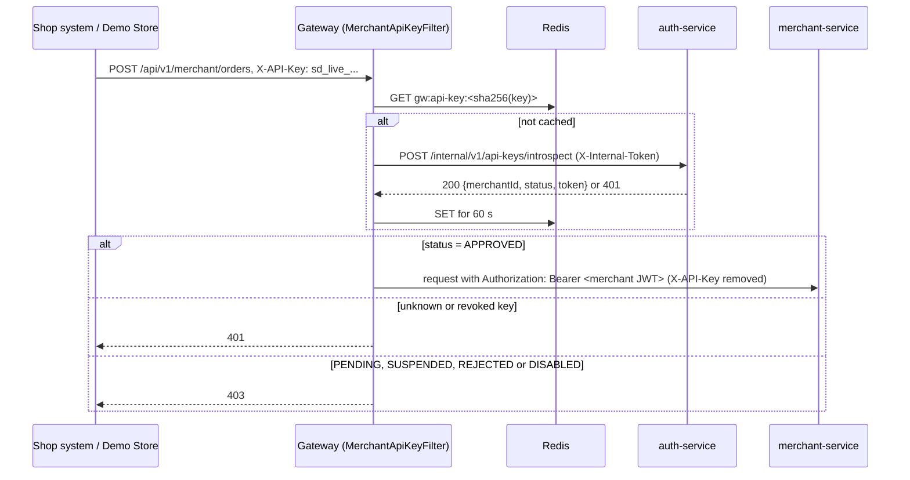

# Security design: identity, merchant credentials and admin controls

Report section 9 (owner M2). Describes what auth-service and the gateway actually enforce in Phase 2.
Code: `services/auth-service` (packages `credentials`, `admin`, `oauth`, `service`) and
`services/gateway/.../MerchantApiKeyFilter.java`.

## 9.1 Who authenticates how

| Caller | Credential | What it gets |
|---|---|---|
| Customer, courier, dispatcher, admin, merchant staff | Email and password (BCrypt, cost 12), or Google sign-in (OAuth 2.0 authorisation code with PKCE S256) | RS256 access token (15 min) and a rotating refresh token, both in HttpOnly SameSite=Lax cookies |
| A merchant's own shop system | API key (`X-API-Key` header) | Exchanged at the gateway for a 15-minute merchant JWT |
| A merchant's own shop system | OAuth 2.0 client credentials (client id + secret) | `POST /api/v1/auth/oauth/token` returns a 15-minute merchant JWT |
| Another SwiftDrop service | `X-Internal-Token` shared secret on `/internal/**` | Service-to-service calls only; the gateway answers 404 for `/internal/**` |

Every service validates JWTs against auth-service's JWKS (`/.well-known/jwks.json`). Roles come from the `roles`
claim. The gateway applies coarse role rules per path, and each service re-checks with `@PreAuthorize` (defence in depth).

## 9.2 Merchant API keys and OAuth clients

An approved merchant creates credentials on the **API keys** page (`/merchant/api-keys`), or with
`POST /api/v1/auth/merchant/credentials {type: API_KEY | CLIENT, name}`. The merchant **Webhooks** page uses
`/api/v1/auth/merchant/api-keys` (create, list, revoke API keys); it is backed by the same service and table, so a key
made on either page works the same everywhere.

| Property | Design |
|---|---|
| Format | API key `sd_live_<43 random chars>`. Client id `sd_client_<16 chars>`, secret `sd_secret_<43 chars>`. 256 random bits from `SecureRandom`. The `sd_live_` prefix lets leaked keys be recognised by secret scanners |
| Storage | Only the SHA-256 of the secret (`auth.api_credentials.secret_hash`). A fast hash is appropriate because the secret is 256 random bits, not a user-chosen password; it also allows lookup by hash at the gateway's rate. The UI shows only the first 14 characters |
| Disclosure | The secret is returned once, in the `201` response (`Cache-Control: no-store`). It cannot be retrieved again; a lost key is replaced by creating a new one and revoking the old |
| Revocation | `DELETE /api/v1/auth/merchant/credentials/{id}` sets `revoked_at`; the row is kept for audit. A revoked key gets 401 at introspection, a revoked client gets `invalid_client` |
| Who may manage keys | Role MERCHANT **and** merchant status APPROVED **in the database** (not the token claim, which can be stale) **and** an active login. Tokens that carry a `scope` claim (machine tokens) are refused, so a leaked `orders:write` token cannot mint new keys |
| Scope | Every credential is limited to `orders:write` |
| Traceability | `last_used_at` is updated on each use; creating and revoking write audit rows |

### API key flow (Demo Store, scenario 2)

The raw key is never stored or forwarded past the gateway; downstream services only ever see JWTs.
Introspection returns a token only for an active, approved merchant.

### Client credentials flow

`POST /api/v1/auth/oauth/token`, form-encoded `grant_type=client_credentials`, client authenticated by HTTP Basic
(preferred) or `client_id`/`client_secret` form fields (RFC 6749 section 4.4). The secret is compared in constant time.
Errors are RFC 7807 problem details that also carry the RFC 6749 `error` code:

| Situation | Response |
|---|---|
| Success | 200 `{access_token, token_type: "Bearer", expires_in: 900, scope: "orders:write"}`, `Cache-Control: no-store` |
| Unknown client, wrong secret, revoked client | 401 `invalid_client` with `WWW-Authenticate` |
| Merchant not approved, or login disabled | 403 `unauthorized_client` |
| Any grant other than client_credentials | 400 `unsupported_grant_type` |

### Merchant JWT claims

| Claim | Value |
|---|---|
| `sub` | Merchant's user id |
| `merchantId` | Merchant's user id (decided in one place, `MerchantIdentity`, so it can change if the cross-service contract does) |
| `roles` | `["MERCHANT"]` |
| `merchantStatus` | `APPROVED` |
| `scope` | `orders:write` |
| `exp - iat` | 900 seconds |

## 9.3 Service-to-service calls

Paths under `/internal/**` require `X-Internal-Token` equal to the `INTERNAL_TOKEN` setting (constant-time compare,
fails closed when unset). A user JWT is not enough (403). The gateway returns 404 for `/internal/**` before any
security check, so these endpoints are unreachable from outside. auth-service exposes:

- `POST /internal/v1/api-keys/introspect` for the gateway (M1)
- `GET /internal/v1/users/{id}/contact` for notification-service (M5): id, email and name only

## 9.4 Admin controls and audit

| Action | Endpoint (ADMIN only) | Effect |
|---|---|---|
| Approve / reject merchant | `POST /admin/merchants/{id}/approve` and `/reject` | Approval also writes a `merchant.approved` event to the outbox in the same transaction |
| Suspend / reinstate merchant | `POST /admin/merchants/{id}/suspend` and `/reinstate` | A suspended merchant's keys and clients stop receiving tokens; reinstating restores them |
| Disable / enable user | `POST /admin/users/{id}/disable` and `/enable` | Disabling revokes all of the user's refresh tokens; login and refresh fail. An admin cannot disable their own account |
| Create courier or dispatcher | `POST /admin/users` | Initial password set by the admin |
| List users | `GET /admin/users?role=&status=&q=&page=&size=` | Phones masked |
| Read audit log | `GET /admin/audit-logs?action=&actorId=` | Newest first, with the actor's email |

Every admin action, and every API credential created or revoked, writes a row to `auth.audit_log`
(actor, action, target, time). The API offers no way to change or delete audit rows.

## 9.5 Personal data

- **At rest:** phone numbers are encrypted with AES-256-GCM and a random IV per value (`PiiEncryptor`); the key comes
  from `PII_ENCRYPTION_KEY`.
- **In API responses:** the admin user list shows phones masked as `+9477*****67`; `/me` and the other auth responses
  return no phone at all.
- **In logs:** common-lib's `MaskingConverter` masks emails, phone numbers and JWTs (for example `m***@swiftdrop.test`).
- **In events:** events carry ids only. `merchant.approved` contains just `merchantId`; consumers that need contact
  details call the internal contact endpoint at send time.
- **Secrets:** none in code. JWT keys, the PII key, the internal token and the seed password come from `.env`
  (generated by `scripts/dev-keys.sh`) and are listed in `.env.example`.

## 9.6 Known limits and trade-offs

| Limit | Why it is acceptable |
|---|---|
| A revoked key or suspended merchant can still pass the gateway for up to 60 s | The gateway caches introspection results in Redis for 60 s to keep auth-service off the hot path. Shorten the TTL if faster cut-off is needed |
| An access token stays valid for up to 15 min after its user is disabled or its merchant suspended | Tokens are stateless; refresh is refused at once, so the window is one token lifetime |
| API keys do not expire on their own | Merchants rotate by creating a new key and revoking the old one; `last_used_at` shows unused keys |
| The demo seed can register a known Demo Store key (`DEMO_STORE_API_KEY`) | Only when `SEED_DEMO_DATA=true`; stored as a hash like any other key, never logged |

## 9.7 Evidence (automated tests in `services/auth-service`)

| Test class | Proves |
|---|---|
| `InternalEndpointsTest` | `/internal/**` needs the internal token; introspection contract used by the gateway; only the hash stored |
| `CredentialFlowIntegrationTest` | Create, list and revoke; pending merchant 403; machine token cannot mint keys; client-credentials grant and its errors; expired JWT rejected |
| `AdminIntegrationTest` | User list filters, paging and masking; disable revokes sessions; suspend stops keys; `merchant.approved` envelope in the outbox; audit log |
| `SeedDemoStoreKeyTest` | Demo Store key is seeded once, as a hash, and works at introspection |
| `AuthorizationTest`, `AuthFlowIntegrationTest`, `GoogleLoginIntegrationTest` | Role rules, login and refresh rotation, Google PKCE |
